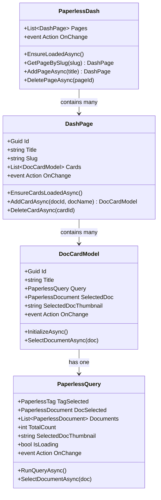
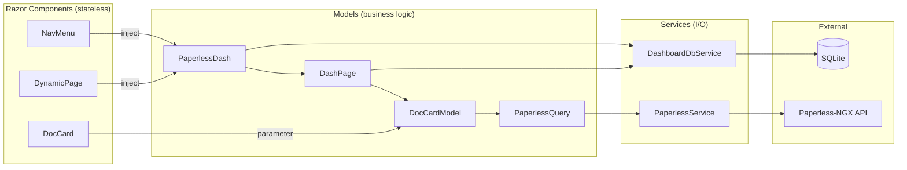

# Architecture — PaperlessDashBlazor

> Blazor Server dashboard for Paperless-NGX.
> Last updated: 2026-11-21

## Project Structure

```
PaperlessDashBlazor/
├── Data/                          # EF Core / SQLite
│   ├── AppDbContext.cs            # DbContext with PageEntity + CardEntity
│   └── Entities.cs                # PageEntity, CardEntity (DB schema)
│
├── Models/                        # Business logic (UI-agnostic)
│   ├── PaperlessDash.cs           # Top-level model: list of pages, page CRUD
│   ├── DashPage.cs                # One page: list of cards, card CRUD
│   ├── DocCardModel.cs            # One card: wraps PaperlessQuery
│   ├── QueryModels.cs             # PaperlessQuery (run queries, select docs)
│   └── PaperlessModels.cs         # API DTOs: PaperlessTag, PaperlessDocument, PaperlessPage<T>
│
├── Services/                      # External I/O
│   ├── DashboardDbService.cs      # Thin DB service (EF Core CRUD, no business logic)
│   └── PaperlessService.cs        # HTTP client for Paperless-NGX API
│
├── Components/
│   ├── Layout/
│   │   ├── MainLayout.razor       # App shell (sidebar + content)
│   │   └── NavMenu.razor          # Sidebar: page list + add/delete pages
│   ├── Pages/
│   │   ├── DynamicPage.razor      # Card grid + add-card dialog
│   │   ├── DocCard.razor          # Single doc card (thumbnail + header)
│   │   ├── Home.razor             # Welcome page
│   │   ├── Error.razor            # Error page
│   │   └── NotFound.razor         # 404 page
│   ├── App.razor, Routes.razor, _Imports.razor
│
├── Program.cs                     # DI registration, pipeline setup
└── .env                           # PAPERLESS_URL, PAPERLESS_API_TOKEN
```

## Class Hierarchy



## Data Flow



## Design Principles

1. **Razor = stateless renderers** — Components receive model objects via `@inject` or `[Parameter]`. They render HTML and forward user actions to model methods. Only dialog UI state (open/closed, loading spinners) lives in `@code`.

2. **Models = state + business logic** — `PaperlessDash` → `DashPage` → `DocCardModel` → `PaperlessQuery` form a tree of aggregates. Each holds its children and exposes CRUD methods.

3. **Services = thin I/O** — `DashboardDbService` does raw DB operations. `PaperlessService` does HTTP calls. Neither holds business state.

4. **Change notification via events** — Each model fires `OnChange` when state changes. Razor components subscribe and call `StateHasChanged()`. Changes bubble up: `PaperlessQuery.OnChange` → `DocCardModel.OnChange` → `DocCard.razor` re-renders.

5. **Scoped lifetime** — `PaperlessDash`, `DashboardDbService`, and `PaperlessService` are all Scoped (one per Blazor circuit). `NavMenu` and `DynamicPage` share the same `PaperlessDash` instance within a circuit.

## DB Schema

| Table | Columns |
|-------|---------|
| `Pages` | Id (Guid PK), Title, Slug (unique index) |
| `Cards` | Id (Guid PK), DocId (int?), DocName (string?), PageId (FK → Pages, cascade delete) |

No EF migrations — uses `EnsureCreated()`. Delete `paperless-dash.db` if schema changes.
