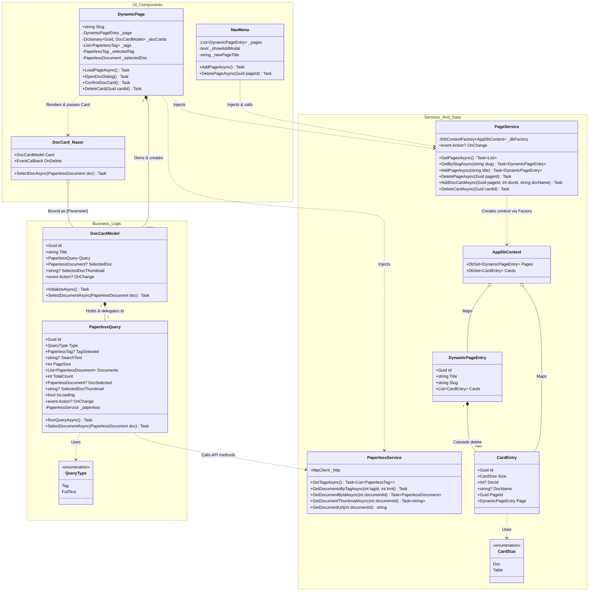
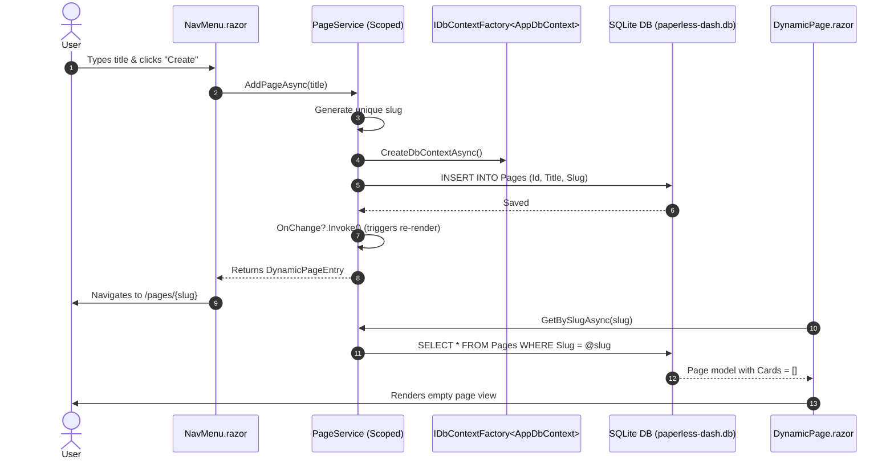
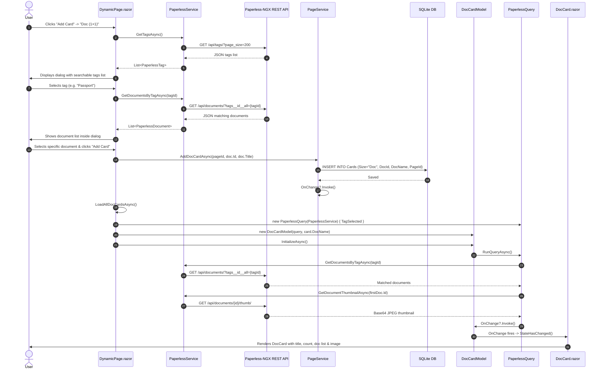

# PaperlessDashBlazor Architecture & Flow Diagrams

This document outlines the class hierarchy, relationships, and execution stacks for key user interactions across the Blazor UI, service layer, Paperless-NGX REST API, and SQLite database.

---

## 1. Class Structure & Relationships

The following class diagram shows the system layers: **Presentation (Blazor Components)**, **Card & Query Business Logic**, **Integration Services**, and **Database Entities (EF Core)**.



---

## 2. User Flows & Execution Stacks

### Flow A: User Creates a New Page



---

### Flow B: User Adds a 1×1 Doc Card



---

### Flow C: User Clicks a Different Document in the DocCard

```mermaid
sequenceDiagram
    autonumber
    actor User
    participant CardUI as DocCard.razor
    participant CardModel as DocCardModel
    participant Query as PaperlessQuery
    participant Paperless as PaperlessService
    participant RestApi as Paperless-NGX REST API

    User->>CardUI: Clicks on a document row in the list
    CardUI->>CardModel: SelectDocumentAsync(doc)
    CardModel->>Query: SelectDocumentAsync(doc)
    Query->>Query: DocSelected = doc, SelectedDocThumbnail = null
    Query->>Query: NotifyChanged() -> CardUI renders loading placeholder
    Query->>Paperless: GetDocumentThumbnailAsync(doc.Id)
    Paperless->>RestApi: GET /api/documents/{doc.Id}/thumb/
    RestApi-->>Paperless: Binary JPEG bytes
    Paperless-->>Query: "data:image/jpeg;base64,..."
    Query->>Query: SelectedDocThumbnail = base64Data
    Query->>CardModel: NotifyChanged()
    CardModel->>CardUI: OnChange fires -> StateHasChanged()
    CardUI->>User: Selected row highlighted + new thumbnail displayed
```

