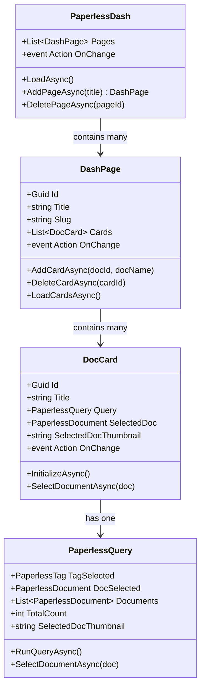

now it is clear, 

lets do something like this.

_models -> hold   _dbentry  which is a clean obj passed aroung between child and razor and most likly read only, will he equavelt to bd
_models is buisciess logic stired _dbentry, als its child aggregates and buisness logic and call to gb, its consrcutor is (_dbentry)

# Restructuring Plan — PaperlessDashBlazor

## Goal
Separate business logic from Razor UI. Razor components become **stateless** renderers that receive model objects via `[Parameter]`. All state and logic lives in C# model classes.

## New Architecture

## File Changes

### New Files
| File | Purpose |
|------|---------|
| `Models/PaperlessDash.cs` | Top-level app state: list of pages, add/delete pages |
| `Models/DashPage.cs` | One page: list of cards, add/delete cards |
| `Models/DocCard.cs` | One card: wraps PaperlessQuery (moved from Services/) |
| `Data/Entities.cs` | EF entities: `PageEntity`, `CardEntity` (renamed from DynamicPageEntry/CardEntry) |

### Modified Files
| File | Changes |
|------|---------|
| `Services/QueryModels.cs` | Keep PaperlessQuery, remove SetTagAndRunAsync (dead), keep QueryType |
| `Services/PaperlessService.cs` | Keep as-is (HTTP client) |
| `Services/PaperlessModels.cs` | Keep as-is (API DTOs) |
| `Data/AppDbContext.cs` | Update to use new entity names |
| `Program.cs` | Register PaperlessDash as Scoped, rename PageService → DashboardDbService |
| `Components/_Imports.razor` | Add `@using PaperlessDashBlazor.Models` |
| `Components/Layout/MainLayout.razor` | Inject PaperlessDash, pass to NavMenu |
| `Components/Layout/NavMenu.razor` | Stateless: receive PaperlessDash via Parameter |
| `Components/Pages/DynamicPage.razor` | Stateless: receive DashPage via model lookup, dialog state only for UI |
| `Components/Pages/DocCard.razor` | Already mostly stateless, simplify |

### Deleted Files
| File | Reason |
|------|--------|
| `Services/PageService.cs` | Entities moved to Data/Entities.cs |
| `Services/PageServiceImpl.cs` | Logic split: DB ops → DashboardDbService, business logic → Models |
| `Services/DocCard.cs` | Moved to Models/DocCard.cs |

### Renamed Services
| Old | New | Why |
|-----|-----|-----|
| `PageService` (class in PageServiceImpl.cs) | `DashboardDbService` | Clearer name, DB-only operations |
| `DynamicPageEntry` | `PageEntity` | Cleaner entity name |
| `CardEntry` | `CardEntity` | Cleaner entity name |
| `CardSize` enum | Removed | Only Doc cards for now |

## Execution Order

1. Create `Data/Entities.cs` with renamed entities
2. Create `Services/DashboardDbService.cs` (slim DB-only service)
3. Create `Models/DocCard.cs`
4. Create `Models/DashPage.cs`
5. Create `Models/PaperlessDash.cs`
6. Update `Data/AppDbContext.cs`
7. Update `Services/QueryModels.cs` (remove dead code)
8. Update `Program.cs` (new DI registrations)
9. Update `Components/_Imports.razor`
10. Rewrite `Components/Layout/MainLayout.razor`
11. Rewrite `Components/Layout/NavMenu.razor` (stateless)
12. Rewrite `Components/Pages/DynamicPage.razor` (stateless)
13. Simplify `Components/Pages/DocCard.razor`
14. Delete old files
15. Build & verify
16. Update ARCHITECTURE.md

